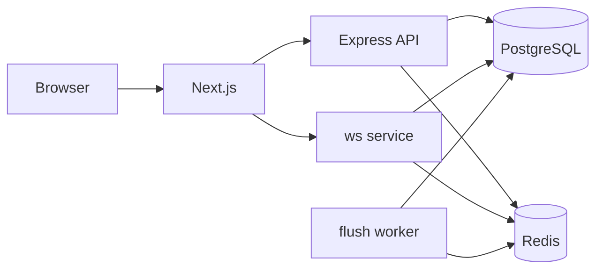

# Architecture and design decisions

## Shape

This is a modular monorepo with separately runnable processes, not a single server and not automatically a microservice system. `apps/web`, `apps/http-server`, `apps/ws-server`, and `apps/flush-worker` compose shared `packages/*`.

## Boundaries and request path

HTTP serves Better Auth and scene/room/library operations. The WebSocket process validates room tickets and collaboration protocol messages. PostgreSQL owns durable users, scenes, access and revisions. Redis coordinates live room state, pub/sub, leases, limits and queueing. The worker persists queued snapshots. `common` is browser/server-neutral; `backend-common` is server-only; `db`, `auth`, `redis` centralize infrastructure access.

`apps/http-server/src/app.ts` applies credentialed CORS, mounts Better Auth before JSON parsing (preserves raw body), sets a 50 MB JSON limit, then health/me and auth-protected route groups. `requireAuth` resolves session and sets user identity.

## Decisions (retrospective justification)

| Choice | Evidence / advantage | Trade-off and change trigger |
|---|---|---|
| Workspace monorepo | pnpm workspaces and Turbo; protocol/domain types shared directly | Coordinated releases and coupling; split only for distinct ownership or release/security requirements. |
| Separate HTTP, WS, worker processes | Independent entrypoints; long-lived sockets and jobs isolated from HTTP lifecycle | More config/deployment. Consolidate only for small scale if independent resource profiles are not useful. |
| Postgres durable + Redis live | Relational constraints and revision history with low-latency room state | Dual-store consistency; define RPO and consider outbox if crash window is unacceptable. |
| Revision log + snapshots | `Scene.syncRevision`; unique `(sceneId, revision)`; worker retains recent revisions | More reconciliation/retention. This is not full event sourcing. |
| Ephemeral vs committed events | Protocol differentiates previews/presence and accepted changes | Client must reconcile previews and revisions correctly. |
| Shared `common` / `engine` | Avoid duplicate protocol and drawing behavior | Boundary discipline; engine uses common contracts. |

No ADR was identified proving original alternatives or motives. These are technical arguments that fit the implementation.

## Coupling and failure

The expected dependency graph is in [repository architecture](diagrams/repository-architecture.mmd). Keep UI out of server packages and DB/auth/Redis server-only code out of browser bundles. `@repo/ui` exists but web manifest does not declare it, so runtime use is not assumed.

HTTP startup asserts auth configuration and connects DB/Redis; failures exit. Its `/health` is process-only. WS access depends on auth/DB and Redis lease behavior. Worker logs failed jobs and periodically scans dirty rooms (startup and 60-second interval) to recover queue gaps. These mechanisms do not prove exactly-once writes.

For scale, stateless HTTP can run behind a load balancer; WS requires shared fanout/leases and upgrade-capable proxying. Worker concurrency and DB pools need measurement. See [scalability](13-scalability-and-performance.md).
